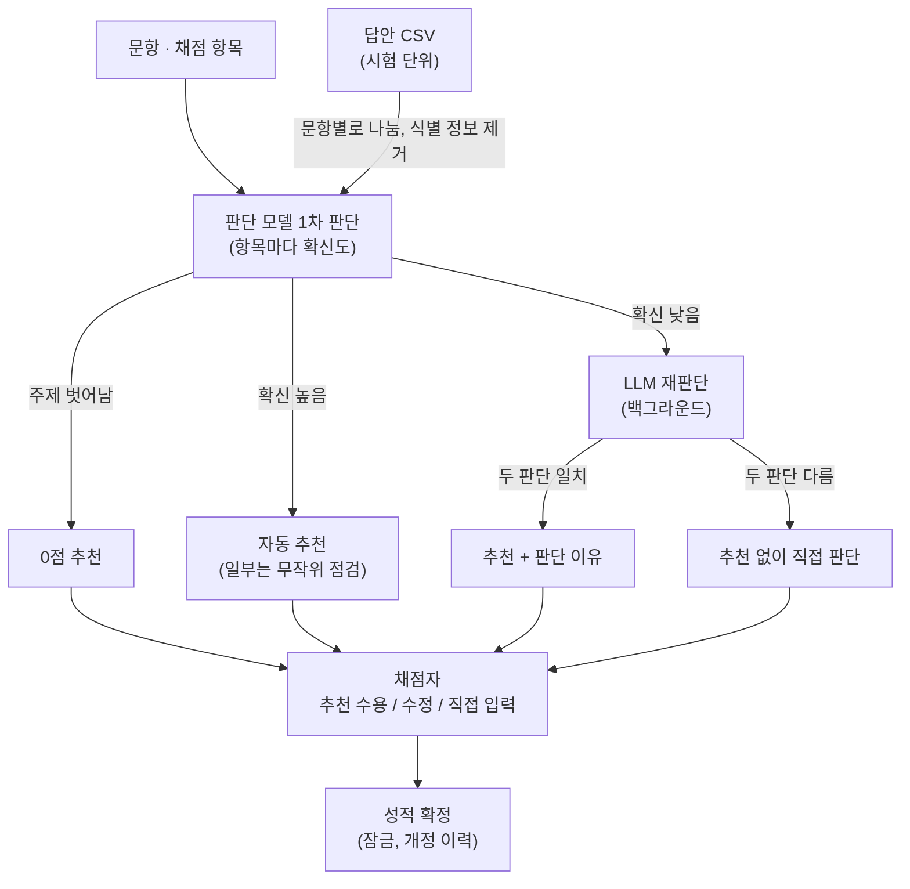

# FastABC

**서술형 채점, 봐야 할 곳부터.**

대학 교수·조교를 위한 서술형 답안 채점 보조 도구입니다. AI가 모든 답안을 채점 기준 항목별로 먼저 읽고 애매한 곳만 골라 드리며, 점수는 채점자가 확정합니다. 채점 기준이 "이 내용을 썼는가"로 나뉘는 개념·원리 설명형 문제에 맞춰져 있습니다.

**이름의 뜻.** FastABC는 ABC(학점)를 빠르게 매긴다는 뜻입니다. 빠르다는 것은 답안을 덜 읽는다는 뜻이 아닙니다. 채점자는 모든 답안을 읽고, AI는 사람의 판단이 흐려지기 쉬운 곳을 짚어 줍니다. AI의 판단도 흐려질 수 있으므로, AI가 확신하지 못하거나 의견이 갈린 곳은 채점자가 정합니다. 사람과 AI가 서로의 약한 곳을 보완해서 빨라집니다.

[사용 시나리오](docs/scenario.md) · [개발 문서](docs/development.md) · 서비스 https://fastabc.grntcds.net · 시연 영상 · 결과보고서 · 포스터 _(추가 예정)_

## 왜 만들었나

- 서술형 답안 수십 장을 같은 기준으로 끝까지 읽는 일은 느리고, 뒤로 갈수록 판단이 흐려집니다.
- LLM에 채점을 통째로 맡기면 점수의 책임이 흐려집니다. 답안마다 수 초가 걸리고 비용도 들며, LLM이 스스로 밝힌 확신도는 믿기 어렵습니다.
- FastABC는 역할을 나눕니다. 판단 모델이 확신도로 칸을 거르고, LLM은 애매한 칸만 다시 보며, 점수·분기·라우팅 규칙은 코드가 정합니다. 점수 확정은 사람이 합니다.

## 주요 기능

### 1. 과목 · 시험 · 문항

- 과목(학기·분반)을 만들고 그 안에 시험을, 시험 안에 문항을 둡니다.
- 문항은 문제와 **채점 항목**으로 만듭니다: 항목 이름, 가점·감점, 배점, AI가 확인할 내용. 답안이 문제와 관련 있는지 보는 주제 확인 항목은 저장할 때 자동으로 붙습니다.

### 2. 답안은 시험 단위로 한 번에

- LMS에서 받은 **CSV**(학번·이름·문항별 답)를 시험 화면에서 한 번 올리면 문항마다 나뉘어 들어갑니다. 빈 칸은 미제출입니다.
- 이미 있는 학생과 성적 확정된 문항은 건너뜁니다.
- AI에는 **이름·학번·연락처를 지운 답안만** 보냅니다.

### 3. AI가 먼저 읽고, 애매한 곳만 사람에게

- **판단 모델**이 모든 답안의 모든 항목을 1차 판단합니다(답안당 약 0.3초).
- 확신이 낮은 항목만 **LLM**이 백그라운드에서 다시 판단하고, 두 판단이 다르면 추천 없이 채점자에게 넘깁니다. 진행 상황은 문항 화면에 나타납니다.
- 평가셋에서 AI가 확신한 항목이 87%, 그 정확도는 94.6%였습니다([평가 결과](#평가-결과)).

### 4. 모든 답안을 순서대로, 볼 곳은 표시해서

- 채점 화면은 학생 목록, 문제, 답안, 항목별 점수 칸으로 이루어집니다. 학생마다 확인이 필요한 항목 수가 보입니다.
- 확인이 필요한 항목에는 이유가 붙습니다: **AI 의견이 갈림**(두 판단을 나란히) · **AI가 다시 확인함**(판단 이유) · **무작위 점검**.
- 점수 칸은 **미리 채우지 않습니다.** AI 추천은 점선으로만 표시하고, 칸을 눌러야 확정됩니다.
- 볼 곳을 직접 정한 뒤 "확인 필요 외 n개 항목 추천대로 확정하고 다음 학생으로"를 누르면, AI가 확신한 나머지 항목을 확정하고 다음 학생으로 넘어갑니다. 문항 전체를 한 번에 확정하는 버튼은 두지 않았습니다. 모든 답안을 사람이 한 번은 읽게 하려는 것입니다.

### 5. 점수는 사람이 확정하고, 기록이 남는다

- 확정은 **추천 수용 · 수정 · 직접 입력**으로 기록됩니다.
- **성적 확정**은 책임 확인 후 확정자·시각·결과 해시를 남기고 문항을 잠급니다.
- 고칠 때는 사유를 적고 **개정**합니다. 이전 확정 기록은 남고, 다시 확정하면 새 버전이 됩니다.

### 6. 시험 결과

- 학번으로 문항별 점수를 묶어 **학생별 합계**를 냅니다. 답안이 없는 문항은 미제출(0점)이고, 미확정 항목이 있으면 합계를 비워 둡니다.

## 동작 방식

판단 모델이 채점 기준 항목마다 1차 판단을 하고, 확신이 낮은 칸만 LLM이 다시 판단합니다. 시스템은 추천 점수와 확신도, 판단 이유만 보여 주고, 모든 점수는 채점자가 확정합니다.



| 판단 결과 | 채점자 화면 | 추천 | 한 번에 확정 |
|---|---|---|---|
| 확신 높음 | 표시 없음 | 있음 | 가능 |
| 확신 높음 + 무작위 점검 | 무작위 점검 | 있음 | 불가 |
| LLM과 일치 | AI가 다시 확인함 | 있음 + 판단 이유 | 불가 |
| LLM과 다름 | AI 의견이 갈림 | 없음 | 불가 |
| 주제 벗어남 | 표시 없음 | 0점 | 가능 |

## 평가 결과

직접 출제하고 직접 라벨링한 합성 평가셋으로 측정했습니다. 2문항, 답안 24건, 150칸입니다. 원본과 분석은 [data/eval/runs/20261108-173844](data/eval/runs/20261108-173844/summary.md)에 있습니다.

| | 하이브리드 | LLM 단독 |
|---|---|---|
| 라벨 일치도 (추천이 나온 칸) | 92.1% (자동 칸만 94.6%) | 90.0% |
| 추천 생성 비용 (답안당) | $0.0022 | $0.0079 |
| 첫 추천까지 (답안당) | 0.27초 | 10.07초 |

- 판단 모델이 확신을 가지고 자동 처리한 칸은 87%입니다. 나머지 13%는 LLM 확인 또는 직접 판단으로 넘어갑니다.
- 평가셋이 작아 수치는 경향으로만 봐야 합니다. 답안 단위 부트스트랩 95% 구간은 하이브리드 87.9–95.7%, LLM 단독 85.6–94.2%이고, 차이(+2.1%p)의 구간은 −0.7–+5.1%p로 0을 포함합니다. 정확도는 같은 수준이고, 차이는 비용과 속도에서 납니다. LLM 확인 칸(10칸)의 정확도는 60%로 낮았고, 그래서 그 칸들도 채점자가 확정하도록 설계했습니다.

## 시작하기

로컬에서 실행하거나, 서버 한 대에 Docker로 올립니다([서버에 올리기](#서버에-올리기)).

### 준비물

- Docker (PostgreSQL 17)
- Python 3.12 이상과 [uv](https://docs.astral.sh/uv/)
- API 키: 판단 모델(TypeSafe Jev), LLM(Google Gemini)

### 설치와 실행

```bash
cp .env.example .env          # TYPESAFE_API_KEY, GEMINI_API_KEY를 채웁니다
uv sync
docker compose up -d --wait db
uv run alembic upgrade head
uv run python scripts/seed_demo.py --empty   # 데모 계정과 문항 (아래 참고)
uv run fastapi dev app/main.py               # http://localhost:8000
```

가입 화면은 없습니다. 계정은 시드 스크립트가 만드는 데모 계정(`demo@fastabc.kr` / `demo1234`, 김조교)을 씁니다.

### 데모 데이터

```bash
uv run python scripts/seed_demo.py           # 세 문항 모두 채점된 상태 (판단 모델·LLM 실제 호출, 몇 분)
uv run python scripts/seed_demo.py --empty   # 1·2번 문항과 채점 기준만, 답안 없이
```

과목 「정보보호개론」 중간고사(서술형 3문항)를 만듭니다.

- 1번 「비밀번호 저장」: 답안 12건. 확정까지 마친 상태입니다.
- 2번 「SQL 인젝션」: 답안 40건. 채점만 하고 검토는 남겨 둔 상태입니다.
- 3번 「대칭키와 공개키 암호」: 답안 40건. 채점만 하고 검토는 남겨 둔 상태입니다.

데모 답안은 모두 합성 데이터입니다. 실제 학생 답안을 다룰 때는 입력 데이터가 학습에 쓰이지 않는 유료 API 계정을 쓰세요.

### 테스트

```bash
uv run pytest     # 별도 DB fastabc_test, 외부 API 호출 없음
```

### 서버에 올리기

Docker가 있는 리눅스 서버 한 대(메모리 2GB 이상, 80·443 포트 열림)와 그 서버를 가리키는 도메인이 있으면 됩니다. [compose.prod.yml](compose.prod.yml)이 DB, 앱, [Caddy](Caddyfile)를 띄웁니다. 앱이 모든 화면을 직접 그리므로 컨테이너는 이 셋뿐이고, Caddy가 https 인증서를 받아 앱으로 넘깁니다.

```bash
git clone <저장소> fastabc && cd fastabc
cp .env.example .env    # API 키 + DOMAIN, POSTGRES_PASSWORD(영문·숫자만)
docker compose -f compose.prod.yml up -d --build                     # 시작할 때마다 DB 마이그레이션
docker compose -f compose.prod.yml exec api python scripts/seed_demo.py --empty   # 데모 계정과 데이터
```

코드를 고친 뒤에는 `git pull` 후 같은 `up -d --build`를 다시 실행합니다.

## 사용 기술


<br/>


<br/>


| 영역 | 기술 |
|---|---|
| 서버 | FastAPI, SQLAlchemy 2, Alembic, PostgreSQL 17 |
| 화면 | 서버 렌더링(Jinja2), htmx, Pico CSS |
| 판단 | 판단 모델 Jev (TypeSafe), LLM Gemini (Google) |
| 배포 | Docker Compose, Caddy |

서버 코드는 도메인별 폴더(`app/accounts`, `courses`, `problems`, `submissions`, `grading`, `review`)로 나뉩니다. 판단기는 업체 중립 인터페이스(`app/judges`) 뒤에 있어 다른 판단 모델이나 LLM으로 바꿀 수 있습니다. 자세한 구조는 [개발 문서](docs/development.md)에 있습니다.

## 하지 않는 것

- AI 생성 답안 판정, 표절·유사도 검사
- LMS 직접 연동, 이메일 인증·비밀번호 재설정·과목 공유와 역할 구분 (계정은 자기 과목만 봅니다)
- 객관식 채점
- 논술형처럼 글 전체의 완성도를 보는 총체적 채점 (수준별 항목은 정확도가 71.4%로 충족 여부 항목 94.4%보다 낮아, 충족 여부 항목 여러 개로 나누는 쪽을 권합니다)
- 계산 문제의 숫자 검산 (풀이를 문장과 간단한 식으로 쓴 문제는 항목별 부분 점수로 다룹니다)
- 학생 이의 제기 처리 (개정 기능으로 점수 변경과 사유만 기록)

## 후속 과제

- 답안 입력: 답안지 PDF·사진·카메라 판독, 워드·한글 파일
- 채점 보조: 채점 기준 문장을 항목으로 자동 변환, 답안의 근거 문장 표시, 항목별 보기
- 결과 활용: CSV 내보내기, 성적표·학생별 채점 근거표 PDF, 점수 분포, 객관식 점수 가져오기
- 계정: 로그인과 계정별 과목 분리는 지원하며, 가입 화면·이메일 인증·비밀번호 재설정·과목 공유와 역할을 더할 예정
- 실제 학생 답안과 여러 채점자로 하는 실사용 평가

## 라이선스

[MIT License](LICENSE)

## 만든이

팀 JMKDEV

| 이름 | 소속 | 학번 |
|---|---|---|
| 김준명 | 단국대학교 AI융합대학 소프트웨어학과 | 32211058 |
