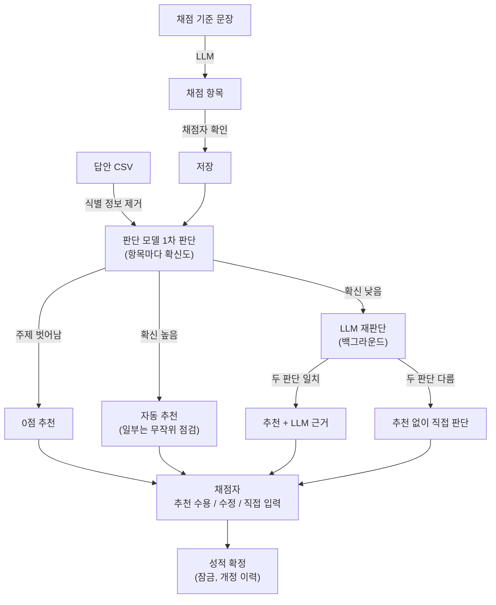

# FastABC

**서술형 채점, 봐야 할 곳부터.**

대학 교수·조교를 위한 서술형 답안 채점 보조 도구입니다. AI가 모든 답안을 채점 기준 항목별로 먼저 읽고 애매한 곳만 골라 드리며, 점수는 채점자가 확정합니다. 채점 기준이 "이 내용을 썼는가"로 나뉘는 개념·원리 설명형 문제에 맞춰져 있습니다.

[사용 시나리오](docs/scenario.md) · [개발 문서](docs/development.md) · 시연 영상 · 결과보고서 · 포스터 _(추가 예정)_

## 왜 만들었나

- 서술형 답안 수십 장을 같은 기준으로 끝까지 읽는 일은 느리고, 뒤로 갈수록 판단이 흐려집니다.
- LLM에 채점을 통째로 맡기면 점수의 책임이 흐려집니다. 답안마다 수 초가 걸리고 비용도 들며, LLM이 스스로 밝힌 확신도는 믿기 어렵습니다.
- FastABC는 역할을 나눕니다. 판단 모델이 확신도로 칸을 거르고, LLM은 애매한 칸만 다시 보며, 점수·분기·라우팅 규칙은 코드가 정합니다. 점수 확정은 사람이 합니다.

## 주요 기능

- **채점 기준 입력:** 교수가 쓴 기준 문장을 그대로 붙여 넣으면 LLM이 채점 항목(충족 여부 또는 수준별, 배점, AI가 확인할 내용)으로 나눕니다. 채점자는 저장하기 전에 항목을 고칩니다.
- **답안 업로드:** 시험 결과 화면의 "답안지 올리기"로 학생마다 시험 전체 답안지(PDF·사진)를 한꺼번에 올리면, 답안지의 "1번", "2번"… 표시로 문항을 나눠 각 문항에 넣고 채점을 시작합니다(글자 PDF는 이 컴퓨터에서 나누고, 스캔·사진은 AI가 문항별로 옮깁니다). 문항이 몇 개든 같은 방식이고, 시연은 3문항입니다. 문항별로는 LMS에서 받은 CSV(학번, 이름, 답안)를 한꺼번에 올리거나, 종이 답안·문서를 한 건씩 또는 학생마다 한 파일씩 여러 개를 한꺼번에 넣습니다. 여러 파일은 파일 이름(예: `20240001_김민수.pdf`)에서 학번과 이름을 읽고, 몇 개씩 동시에 읽어 학생마다 읽음·확인 필요(학번 없음, 이미 올린 학번)·저장됨을 목록과 막대로 보여 줍니다. PDF는 글자가 들어 있으면 이 컴퓨터에서 바로 읽고, 스캔본·사진·웹캠으로 찍은 답안은 AI가 글자로 옮깁니다. 읽은 글은 원본 옆에 띄워 채점자가 확인·수정한 뒤 저장하고, 채점 중이면 "저장하고 바로 채점"으로 그 답안만 채점합니다. 외부 API에는 이름·학번·이메일·전화번호를 지운 답안만 보냅니다. 채점 화면에는 이름과 학번이 보이고, "이름 가리고 채점"을 켜면 `S001` 같은 라벨만 보입니다.
- **하이브리드 판단:** 판단 모델이 모든 칸을 1차 판단합니다(답안당 약 0.3초). 확신 낮은 칸은 LLM이 백그라운드에서 답안 4개씩 동시에 다시 판단하고, 두 판단이 다르면 추천 없이 채점자에게 넘깁니다.
- **봐야 할 곳부터:** 진행 막대가 AI가 확신한 비율과 확인할 학생 수를 보여 줍니다. 확인이 필요한 학생부터 정렬하고, 확인이 필요한 항목에는 이유(AI 의견이 갈림, AI가 다시 확인함, 무작위 점검)를 붙입니다. 답안은 시험지처럼 문제 아래에 보이고, 항목별 근거 문장을 색으로 표시합니다. 펼친 항목 안에도 근거 문장을 앞뒤 문맥과 함께 인용해, 답안으로 다시 올라가지 않고 판단할 수 있습니다. 점수 칸은 미리 채우지 않습니다.
- **확정:** 항목마다 추천대로 확정하거나 점수를 고르고, 기록은 추천 수용, 수정, 직접 입력으로 남습니다. AI 의견이 갈린 항목은 두 판단을 나란히 보여 주고 채점자가 고릅니다. 확인이 필요 없는 항목만 한 번에 확정할 수 있고, 확신 높은 칸의 약 10%는 무작위 점검으로 빼 두고, 그 항목 안에 왜 골랐는지 한 줄로 알려 줍니다. 결과 탭에는 무작위 점검에서 AI 추천을 고친 수를 보여 줍니다.
- **항목별 보기:** 한 항목의 모든 학생 칸을 나란히 놓고 기준이 흔들린 곳을 찾습니다.
- **시험 결과:** 문항을 시험(중간고사 등)으로 묶고, 학번으로 문항별 결과를 모아 학생마다 합계를 냅니다. 객관식·계산 문항처럼 다른 곳에서 채점한 점수는 CSV로 가져와 한 열로 더합니다.
- **계정:** 로그인 전 첫 화면은 소개 화면입니다. 이메일로 가입하고 로그인합니다. 채점자는 자기 과목만 보고, 성적 확정에는 로그인한 계정이 확정자로 남습니다.
- **성적 확정:** 채점자가 직접 확인한 항목과 AI 추천을 고친 항목을 막대로 보여 준 뒤, 책임 확인을 받고 로그인한 채점자를 확정자로, 결과 스냅샷의 해시와 함께 기록한 뒤 점수를 잠급니다. 고칠 때는 사유를 적고 개정하며, 다시 확정하면 새 버전으로 남습니다. 내보내기는 CSV와 A4 PDF 성적표 두 가지입니다. 보관용 PDF엔 확정자·시각·결과 해시가 찍히고, 공지용 PDF는 학번 가운데를 가리고 이름은 빼거나 가운데만 가려 그대로 게시할 수 있습니다. CSV 파일 이름에 버전과 해시가 붙습니다. 학기마다 학사일정의 중간고사·기말 성적 입력 마감일을 넣어 두면 문항이 속한 시험에 맞는 마감까지 남은 날짜를 보여 주고, 마감이 지난 뒤 확정할 때는 한 번 더 물은 뒤 "마감 후 확정"으로 기록합니다.

## 동작 방식

판단 모델이 채점 기준 항목마다 1차 판단을 하고, 확신이 낮은 칸만 LLM이 다시 판단해 근거를 붙입니다. 시스템은 추천 점수와 확신도, 근거 문장만 보여 주고, 모든 점수는 채점자가 확정합니다.



## 평가 결과

직접 출제하고 직접 라벨링한 합성 평가셋으로 측정했습니다. 2문항, 답안 24건, 150칸입니다. 원본과 분석은 [data/eval/runs/20261108-173844](data/eval/runs/20261108-173844/summary.md)에 있습니다.

| | 하이브리드 | LLM 단독 |
|---|---|---|
| 라벨 일치도 (추천이 나온 칸) | 92.1% (자동 칸만 94.6%) | 90.0% |
| 추천 생성 비용 (답안당) | $0.0022 | $0.0079 |
| 첫 추천까지 (답안당) | 0.27초 | 10.07초 |

- 판단 모델이 확신을 가지고 자동 처리한 칸은 87%입니다. 나머지 13%는 LLM 확인 또는 직접 판단으로 넘어갑니다.
- 근거 찾기는 채점자가 연 답안에만 실행합니다. 모든 답안을 열어도 하이브리드 합계는 $0.0045로 LLM 단독보다 쌉니다.
- 평가셋이 작아 수치는 경향으로만 봐야 합니다. 답안 단위 부트스트랩 95% 구간은 하이브리드 87.9–95.7%, LLM 단독 85.6–94.2%이고, 차이(+2.1%p)의 구간은 −0.7–+5.1%p로 0을 포함합니다. 정확도는 같은 수준이고, 차이는 비용과 속도에서 납니다. LLM 확인 칸(10칸)의 정확도는 60%로 낮았고, 그래서 그 칸들도 채점자가 확정하도록 설계했습니다.

## 시작하기

로컬 실행만 지원합니다.

### 준비물

- Docker (PostgreSQL 17)
- Python 3.12 이상과 [uv](https://docs.astral.sh/uv/)
- Node.js와 pnpm
- API 키: 판단 모델(TypeSafe Jev), LLM(Google Gemini)

### 설치

```bash
cp .env.example .env          # TYPESAFE_API_KEY, GEMINI_API_KEY를 채웁니다
pnpm install                  # 루트: 동시 실행 도구
pnpm --dir frontend install
cd backend && uv sync && cd ..

docker compose up -d --wait db
cd backend && uv run alembic upgrade head && cd ..
```

### 실행

```bash
pnpm dev                      # DB 대기 후 API :8000 + 웹 :3000
```

`http://localhost:3000`을 열고 가입합니다. API 문서는 `http://localhost:8000/docs`에 있습니다.

### 데모 데이터

```bash
cd backend && uv run python scripts/seed_demo.py           # 세 문항 모두 채점된 상태
cd backend && uv run python scripts/seed_demo.py --empty   # 1·2번 문항만, 답안 없이 (시연 영상용)
cd backend && uv run python scripts/make_answer_sheets.py  # 학생 40명의 시험 전체 답안지 PDF
```

[사용 시나리오](docs/scenario.md)의 과목 「정보보호개론」 중간고사(서술형 3문항 + 객관식 점수)를 데모 계정(`demo@fastabc.kr` / `demo1234`, 김조교)으로 만듭니다. 기본은 판단 모델과 LLM을 실제로 호출하며 몇 분 걸립니다. `--empty`는 문항과 채점 기준만 만들고, 답안은 `data/demo/answer_sheets`의 PDF 40개를 시험 결과 화면의 "답안지 올리기"로 넣습니다.

- 중간고사 1번 「비밀번호 저장」: 답안 12건. 확정까지 마친 상태입니다.
- 중간고사 2번 「SQL 인젝션」: 답안 40건([data/demo/sql_injection.csv](data/demo/sql_injection.csv)). 채점만 하고 검토는 남겨 둔 상태입니다.
- 중간고사 객관식: [data/demo/midterm_mc.csv](data/demo/midterm_mc.csv)의 점수를 가져와 시험 결과에 더합니다.

종이 답안 시연(PDF·사진·웹캠으로 추가)을 되풀이하려면, 파일로 넣은 답안만 지웁니다. CSV로 올린 답안은 그대로 남습니다.

```bash
cd backend && uv run python scripts/booth_reset.py --assignment <문항 id> --yes
```

데모 답안은 모두 합성 데이터입니다. 실제 학생 답안을 다룰 때는 입력 데이터가 학습에 쓰이지 않는 유료 API 계정을 쓰세요. 특히 스캔본·사진은 식별 정보를 지우기 전에 AI가 읽으므로(웹캠은 안내 틀 안쪽만 보냄), 답안지 머리의 이름 칸이 함께 나갈 수 있습니다.

### 테스트

```bash
cd backend && uv run pytest              # 별도 DB fastabc_test, 외부 API 호출 없음
cd frontend && pnpm exec tsc --noEmit && pnpm lint
```

## 사용 기술


<br/>


<br/>


| 영역 | 기술 |
|---|---|
| 백엔드 | FastAPI, SQLAlchemy 2, Alembic, PostgreSQL 17 |
| 프론트엔드 | Next.js 16, TanStack Query, Tailwind CSS, shadcn/ui |
| 판단 | 판단 모델 Jev (TypeSafe), LLM Gemini (Google) |

판단기는 업체 중립 인터페이스 뒤에 있어 다른 판단 모델이나 LLM으로 바꿀 수 있습니다. 자세한 구조는 [개발 문서](docs/development.md)에 있습니다.

## 하지 않는 것

- AI 생성 답안 판정, 표절·유사도 검사
- LMS 직접 연동, 이메일 인증·비밀번호 재설정·과목 공유와 역할 구분 (계정은 자기 과목만 봅니다)
- 워드·한글 파일 업로드 (PDF로 저장해 올리면 됩니다)
- 객관식 채점 (LMS·OMR이 낸 점수를 가져와 더하기만 합니다)
- 논술형처럼 글 전체의 완성도를 보는 총체적 채점 (수준별 항목은 정확도가 71.4%로 충족 여부 항목 94.4%보다 낮아, 충족 여부 항목 여러 개로 나누도록 안내합니다)
- 계산 문제의 숫자 검산 (풀이 여부·풀이의 적절성·정답처럼 판단 지점이 적은 문제라 서술형에 집중했습니다. 풀이를 문장과 간단한 식으로 쓴 문제는 항목별 부분 점수로 다루고, 다른 곳에서 채점한 점수는 시험 결과로 가져옵니다)
- 학생 이의 제기 처리 (개정 기능으로 점수 변경과 사유만 기록)

## 라이선스

[MIT License](LICENSE)

## 만든이

팀 JMKDEV

| 이름 | 소속 | 학번 |
|---|---|---|
| 김준명 | 단국대학교 AI융합대학 소프트웨어학과 | 32211058 |
