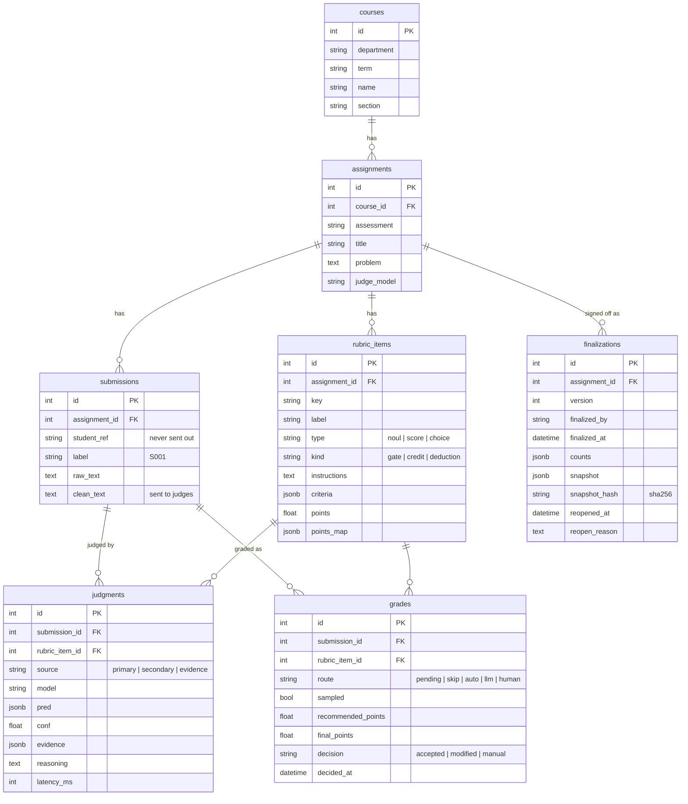

# 개발 문서

FastABC의 구조와 주요 규칙을 설명합니다. 실행 방법은 [README](../README.md)를, 화면 흐름은 [사용 시나리오](scenario.md)를 보세요.

## 설계 원칙

1. **AI는 추천만, 확정은 사람이.** 시스템은 추천 점수, 확신도, 근거만 보여 줍니다. 점수 칸을 미리 채우지 않습니다.
2. **판단 단위는 채점 기준 항목.** 답안 전체를 상태로 두고 항목마다 판단 질문을 던집니다. 항목들은 한 요청에서 함께 평가됩니다.
3. **판단은 판단 모델, 생성은 LLM, 규칙은 코드.** 점수 계산, 분기, 라우팅은 모델 출력이 아니라 코드가 정합니다.
4. **업체 중립.** 공통 코드, API, DB, 화면은 역할 이름(primary/secondary, "판단 모델"/"LLM")만 씁니다. 업체 이름은 어댑터(`app/judges/jev.py`, `gemini.py`)와 조립 지점(`app/grading.py`의 `make_judges`, `get_drafter`)에만 나옵니다.
5. **학생 정보는 밖으로 나가지 않는다.** 외부 API에는 식별 정보를 지운 `clean_text`만 보냅니다.
6. **자동화 편향 방지.** 일괄 수용은 확신 높은 칸만 됩니다. 자동 칸의 일부는 샘플 검토로 빼 두며, 모든 확정은 수용, 수정, 직접 입력으로 기록됩니다.

## 디렉터리

```
backend/
  app/
    main.py            FastAPI 앱, 라우터 등록
    models.py          SQLAlchemy 모델 (아래 데이터 모델)
    schemas.py         요청·응답 Pydantic 스키마
    grading.py         채점 실행: 판단 모델 동기, LLM 재판단 백그라운드. 판단기 조립(make_judges, get_drafter)
    judges/
      base.py          Judge 프로토콜과 Judgment (업체 중립)
      routing.py       라우팅 규칙 (skip / auto / llm / human)
      jev.py           판단 모델 어댑터 (TypeSafe Jev)
      gemini.py        LLM 어댑터 (Google Gemini): 재판단, 근거 찾기, 채점 기준 변환
    drafting.py        채점 기준 문장 → 판단 질문 변환 인터페이스
    scoring.py         판단 → 점수, 항목별 점수 범위, 총점
    redact.py          식별 정보 제거
    progress.py        문항 진행 단계 (답안 대기 → … → 검토 완료 → 확정)
    finalization.py    성적 확정: 스냅샷, 해시, 잠금
    routers/           courses, assignments, drafts, submissions, grading, review, finalizations
  alembic/             마이그레이션
  scripts/             seed_demo.py, export_rubric.py, run_eval.py
  tests/               pytest (실제 API 호출 없음)
  notebooks/           판단기 응답 검증 노트북 (01 Jev, 02 Gemini)
frontend/
  app/                 Next.js App Router 화면
  components/          공용 컴포넌트, shadcn/ui
  lib/                 API 클라이언트, 생성된 타입(api-types.ts), 화면 용어
data/
  eval/                평가셋 (문항, 답안, 채점자 라벨)과 실행 기록(runs/)
  demo/                데모 답안 CSV
docs/                  사용 시나리오, 개발 문서
```

## 데이터 모델



- **칸**은 답안 × 채점 기준 항목입니다. `grades`가 칸 하나의 추천과 채점자 확정을 담고, `judgments`는 판단기의 원본 출력을 모두 남깁니다.
- 주제 확인 항목(`kind = gate`, key `is_on_topic`)은 점수가 없어 `grades`를 만들지 않고 `judgments`에만 남습니다.
- 학생 이름은 저장하지 않습니다. 업로드할 때 식별 정보 제거에만 쓰고 버립니다.

## 채점 흐름

1. **채점 기준 변환** (`POST /rubric-drafts`): LLM이 기준 문장을 판단 질문 목록으로 바꿉니다. 저장하지 않고 편집기로 돌려주며, 채점자가 고친 뒤 문항을 저장합니다.
2. **업로드** (`POST /assignments/{id}/submissions/csv`): 열 이름은 `학번, 답안, 이름` 또는 `student_id, answer, name`입니다. `redact()`가 학번·이름을 지우고, `학번:`·`이름:` 같은 표시와 이메일·전화번호·학번 패턴을 정규식으로 지운 `clean_text`를 만듭니다.
3. **1차 판단** (`POST /assignments/{id}/grade`, `run_primary`): 판단 모델이 답안마다 모든 질문을 한 번에 판단합니다. 각 `Judgment`의 `confident`는 어댑터가 자기 임계값으로 정합니다. Jev는 예/아니오 확신도가 |2p−1|이고 임계값은 0.6이며, 수준과 선택형은 0.8입니다. 라우팅은 `confident`만 읽습니다.
   - 주제 확인에 "아니오"로 확신하면 나머지 칸은 `skip`(0점 추천)입니다.
   - 확신하면 `auto`가 되고, 그중 10%를 `sampled`로 표시합니다. 시드는 문항 id라 다시 채점해도 같은 칸이 뽑힙니다.
   - 확신하지 못하면 `pending`입니다.
4. **재판단** (`escalate`, 백그라운드): `pending` 칸만 모아 LLM에 답안당 한 번 묻습니다. 판단이 같으면 `llm`(추천과 근거)이 되고, 다르거나 LLM이 실패하면 `human`(추천 없음)이 됩니다. 답안마다 커밋하므로 화면이 진행률을 폴링할 수 있습니다.
5. **근거 찾기** (`POST /submissions/{id}/evidence`): 채점자가 답안을 처음 열 때, 아직 LLM 출력이 없는 칸의 근거 문장만 가벼운 설정의 LLM에 묻습니다(`source = evidence`). 경로와 추천은 바꾸지 않으며, 두 번째 호출부터는 아무것도 하지 않습니다.
6. **확정** (`PATCH /grades/{id}`): `accept`는 추천값을, `set`은 입력값을 확정합니다. 결과는 추천과 비교해 `accepted`, `modified`, `manual`로 기록됩니다. `POST /assignments/{id}/accept-confident`는 `auto`와 `skip` 칸 중 샘플이 아닌 칸만 수용합니다.
7. **성적 확정** (아래 절).

확정된 칸이 하나라도 있으면 다시 채점할 수 없습니다(409).

## 판단기 바꾸기

판단기는 `app/judges/base.py`의 프로토콜 하나만 구현하면 됩니다.

```python
class Judge(Protocol):
    def evaluate(self, problem: str, answer: str, questions: Questions) -> list[Judgment]: ...
```

- 1차 판단기는 `Judgment.conf`와 `confident`를 채워야 합니다. 임계값은 모델 버전마다 다시 맞춰야 하므로 어댑터 안에 둡니다.
- 2차 판단기는 `pred`, `evidence`(답안에서 그대로 복사한 문장), `reasoning`을 채웁니다. LLM이 스스로 밝힌 확신도는 쓰지 않습니다.
- 새 판단기는 `app/grading.py`의 `make_judges()`에서만 조립합니다. 채점 기준 변환은 `drafting.RubricDrafter`를 구현해 `get_drafter()`에서 바꿉니다.
- 테스트는 FastAPI 의존성(`get_judges`, `get_drafter`)을 가짜 판단기로 덮어써 외부 API를 부르지 않습니다.

## 성적 확정

- `POST /assignments/{id}/finalizations`는 확정자 이름(공백 불가)과 `confirmed: true`를 받습니다. 확정하지 않은 칸이 있으면 409입니다.
- 학생별 항목 점수, 확정 종류, 총점을 담은 스냅샷을 정렬된 JSON으로 직렬화해 sha256 해시를 만들고, 칸 수와 함께 새 버전으로 저장합니다. 점수가 같으면 해시도 같습니다.
- 최신 버전이 개정되지 않은 동안 문항은 잠깁니다. 칸 확정, 일괄 수용·취소, 답안 업로드, 재확정은 409를 받습니다(`finalization.ensure_unlocked`).
- `POST /assignments/{id}/reopen`은 사유를 필수로 받아 최신 버전에 개정 시각과 사유를 남기고 잠금을 풉니다. 다시 확정하면 다음 버전이 됩니다.
- 잠긴 동안 `export.csv`의 파일 이름은 `assignment_{id}_v{버전}_{해시 앞 8자}.csv`입니다.
- 로그인이 없어 확정자는 입력한 이름으로만 기록됩니다. 인증과 서명은 후속 과제입니다.

## API

| 메서드 | 경로 | 설명 |
|---|---|---|
| GET, POST | `/courses` | 과목 목록, 생성 |
| GET, PUT, DELETE | `/courses/{id}` | 과목 조회(문항과 진행 단계 포함), 수정, 삭제 |
| GET, POST | `/assignments` | 문항 목록, 생성 (채점 기준 포함) |
| GET, PUT, DELETE | `/assignments/{id}` | 문항 조회, 수정(채점 전만), 삭제 |
| POST | `/rubric-drafts` | 채점 기준 문장 → 판단 질문 초안 (저장 안 함) |
| POST | `/assignments/{id}/submissions/csv` | 답안 CSV 업로드 (최대 5 MB, UTF-8 또는 CP949) |
| GET | `/assignments/{id}/submissions` | 답안 목록 (식별 정보 제거본) |
| DELETE | `/submissions/{id}` | 답안 삭제 (확정 칸이 없을 때만) |
| POST | `/assignments/{id}/grade` | 채점 시작 (202, 재판단은 백그라운드) |
| GET | `/assignments/{id}/grading` | 경로별 칸 수, 남은 재판단 |
| GET | `/assignments/{id}/cells` | 칸 목록 (추천, 판단기 출력, 확정) |
| PATCH | `/grades/{id}` | 칸 확정 `accept` / `set` / `clear` |
| POST | `/assignments/{id}/accept-confident` | 확신 높은 칸 일괄 수용 (항목·답안 단위 가능) |
| POST | `/assignments/{id}/clear-decisions` | 확정 일괄 취소 |
| POST | `/submissions/{id}/evidence` | 근거 찾기 (답안당 한 번) |
| GET | `/assignments/{id}/results` | 학생별 항목 점수와 총점 |
| GET | `/assignments/{id}/export.csv` | 점수 CSV 내보내기 |
| GET, POST | `/assignments/{id}/finalizations` | 확정 이력, 성적 확정 |
| POST | `/assignments/{id}/reopen` | 개정 (사유 필수) |

전체 스키마는 서버 실행 중 `http://localhost:8000/docs`에서 볼 수 있습니다.

## 프론트엔드

| 경로 | 화면 |
|---|---|
| `/` | 과목 목록 (학기 탭, 학과 필터) |
| `/courses/[id]` | 과목: 문항 목록, 진행 단계, 다음 행동 버튼 |
| `/courses/[id]/assignments/new` | 문항 만들기: 문제, 기준 문장 → 채점 항목 변환, 편집 |
| `/assignments/[id]` | 문항: 준비(기준, 답안, 채점 실행) / 채점(학생별, 시험지 모양) / 결과(성적 확정, 내보내기) 탭 |
| `/assignments/[id]/edit` | 문항 수정 (채점 전만) |
| `/assignments/[id]/review` | 항목별 보기 |

- API 타입은 백엔드를 띄운 상태에서 `pnpm --dir frontend gen:api`로 `lib/api-types.ts`를 다시 만듭니다.
- 화면 용어는 `lib/rubric.ts`, 진행 단계는 `lib/progress.ts`에 모여 있습니다. 채점자 화면은 내부 경로 이름을 쓰지 않고 아래처럼 바꿔 보여 줍니다.

  | 내부 (`grades.route`, `sampled`) | 채점자 화면 |
  |---|---|
  | `human` | AI 의견이 갈림: 1차 판단과 재확인을 나란히 보여 주고 채점자가 고름 |
  | `llm` | AI가 확신하지 못함: 추천은 있지만 확인 필요 |
  | `auto` + `sampled` | 무작위 점검 |
  | `auto` | 표시 없음: 한 줄로 접히고 "추천대로 확정 (확인 필요 칸 제외)" 대상 |
  | `skip` | 문제와 관련 없는 답안: 모든 항목 0점 추천 |
  | `pending` | AI가 다시 보는 중 |

- 채점 기준 편집기는 판단 질문의 `` `answer` `` 표기를 "답안"으로 보여 주고(`plain`), 채점자가 쓴 "답안"은 저장할 때 되돌립니다(`fromPlain`). 주제 확인 항목(`kind = gate`)은 편집기와 기준 표에서 숨기고 저장할 때 자동으로 넣습니다.
- 근거 문장은 LLM 출력의 `evidence` 인용을 답안에서 공백을 무시하고 찾아 표시합니다(`lib/highlight.ts`). 채점 탭은 같은 위치를 두 곳에 씁니다: 시험지의 색 표시(`annotate`)와, 펼친 항목 안의 앞뒤 문맥을 붙인 인용(`excerpts`). 인용을 누르면 시험지의 해당 표시로 스크롤합니다. 답안에서 찾지 못한 인용은 보여 주지 않습니다.
- Next.js 16에서 동적 `params`는 Promise이고 `cacheComponents`가 켜져 있어, 런타임 데이터는 `<Suspense>` 안에서 읽습니다.

## 평가 도구

채점자가 직접 라벨링한 평가셋으로 하이브리드와 LLM 단독을 비교합니다.

```bash
cd backend
uv run python scripts/export_rubric.py --assignment 7 --id q1_password_storage   # 앱 문항 → data/eval/<id>/question.json, 답안 템플릿
uv run python scripts/run_eval.py run                                            # API 호출, runs/<시각>/raw/*.jsonl에 원본 기록
uv run python scripts/run_eval.py analyze --run ../data/eval/runs/<시각>          # 오프라인 분석: summary.md, CSV, 그래프
```

- `run`은 답안마다 1차 판단, 재판단, LLM 단독 판단, 근거 찾기 네 가지 호출을 기록합니다. 중단되면 `--resume`으로 이어 갑니다.
- `analyze`는 기록만 읽으므로 비용 없이 다시 돌릴 수 있습니다. 라벨 일치도, 경로별 정확도, 임계값별 자동 처리율, 확신도 구간별 정확도, 비용과 지연을 냅니다.
- 라벨은 `answers.csv`에 예/아니오는 `1`/`0`, 수준은 번호로 적고, 판단기를 돌리기 전에 채웁니다.

## 테스트와 규칙

- `cd backend && uv run pytest`: 별도 DB `fastabc_test`에 테이블을 만들고 테스트마다 롤백합니다. 판단기는 가짜로 바꿔 외부 API를 부르지 않습니다.
- 프론트엔드는 `pnpm exec tsc --noEmit`, `pnpm lint`로 확인합니다.
- 스키마를 바꾸면 `uv run alembic revision --autogenerate -m "..."`로 마이그레이션을 만들고 `uv run alembic upgrade head`로 적용합니다.
- API 키는 루트 `.env`에만 둡니다. 무료 LLM 키는 합성 데이터에만 쓰고, 실제 학생 답안은 입력이 학습에 쓰이지 않는 유료 계정으로만 보냅니다.
