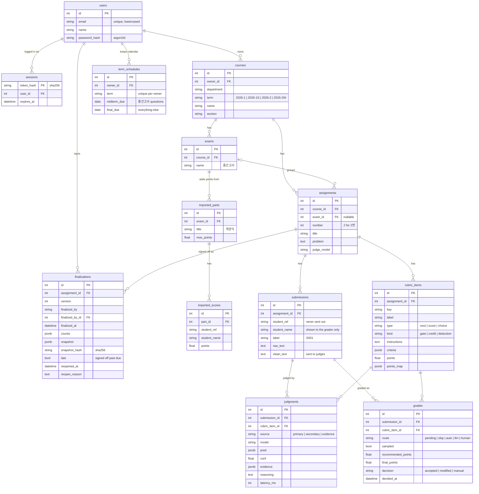

# 개발 문서

FastABC의 구조와 주요 규칙을 설명합니다. 실행 방법은 [README](../README.md)를, 화면 흐름은 [사용 시나리오](scenario.md)를 보세요.

## 설계 원칙

1. **AI는 추천만, 확정은 사람이.** 시스템은 추천 점수, 확신도, 근거만 보여 줍니다. 점수 칸을 미리 채우지 않습니다.
2. **판단 단위는 채점 기준 항목.** 답안 전체를 상태로 두고 항목마다 판단 질문을 던집니다. 항목들은 한 요청에서 함께 평가됩니다.
3. **판단은 판단 모델, 생성은 LLM, 규칙은 코드.** 점수 계산, 분기, 라우팅은 모델 출력이 아니라 코드가 정합니다.
4. **업체 중립.** 공통 코드, API, DB, 화면은 역할 이름(primary/secondary, "판단 모델"/"LLM")만 씁니다. 업체 이름은 어댑터(`app/judges/jev.py`, `gemini.py`)와 조립 지점(`app/grading.py`의 `make_judges`, `get_drafter`)에만 나옵니다.
5. **학생 정보는 밖으로 나가지 않는다.** 외부 API에는 식별 정보를 지운 `clean_text`만 보냅니다. 채점자는 자기 과목만 봅니다.
6. **자동화 편향 방지.** 일괄 수용은 확신 높은 칸만 됩니다. 자동 칸의 일부는 샘플 검토로 빼 두며, 모든 확정은 수용, 수정, 직접 입력으로 기록됩니다.

## 디렉터리

```
backend/
  app/
    main.py            FastAPI 앱, 라우터 등록
    auth.py            비밀번호 해시, 세션 쿠키, 로그인 사용자와 소유권 확인(own_*)
    models.py          SQLAlchemy 모델 (아래 데이터 모델)
    schemas.py         요청·응답 Pydantic 스키마
    grading.py         채점 실행: 판단 모델 동기, LLM 재판단 백그라운드. 판단기 조립(make_judges, get_drafter)
    judges/
      base.py          Judge 프로토콜과 Judgment (업체 중립)
      routing.py       라우팅 규칙 (skip / auto / llm / human)
      jev.py           판단 모델 어댑터 (TypeSafe Jev)
      gemini.py        LLM 어댑터 (Google Gemini): 재판단, 근거 찾기, 채점 기준 변환
    drafting.py        채점 기준 문장 → 판단 질문 변환 인터페이스
    scoring.py         판단 → 점수, 항목별 점수 범위, 총점
    reading.py         PDF·사진 답안 읽기 (텍스트 PDF는 로컬 pypdf, 스캔·사진은 AnswerReader)
    redact.py          식별 정보 제거
    progress.py        문항 진행 단계와 진행 수치 (채점 끝난 학생 수 포함)
    finalization.py    성적 확정: 스냅샷, 해시, 잠금
    routers/           auth, courses, terms, assignments, drafts, submissions, grading, review, finalizations
  alembic/             마이그레이션
  scripts/             seed_demo.py(--empty), make_answer_sheets.py, booth_reset.py, export_rubric.py, run_eval.py
  tests/               pytest (실제 API 호출 없음)
  notebooks/           판단기 응답 검증 노트북 (01 Jev, 02 Gemini)
  Dockerfile           서버용 API 이미지 (시작 때 마이그레이션)
frontend/
  Dockerfile           서버용 웹 이미지 (API는 /api)
  app/                 Next.js App Router 화면
  components/          공용 컴포넌트, shadcn/ui
  lib/                 API 클라이언트, 생성된 타입(api-types.ts), 화면 용어
data/
  eval/                평가셋 (문항, 답안, 채점자 라벨)과 실행 기록(runs/)
  demo/                데모 답안 CSV
docs/                  사용 시나리오, 개발 문서
docker-compose.yml     로컬 개발용 DB
compose.prod.yml       서버 한 대: DB, API, 웹, Caddy
Caddyfile              https와 /api 넘기기
```

## 데이터 모델



- **칸**은 답안 × 채점 기준 항목입니다. `grades`가 칸 하나의 추천과 채점자 확정을 담고, `judgments`는 판단기의 원본 출력을 모두 남깁니다.
- 주제 확인 항목(`kind = gate`, key `is_on_topic`)은 점수가 없어 `grades`를 만들지 않고 `judgments`에만 남습니다.
- 학생 이름과 학번은 채점자 화면에만 씁니다. 외부 API에는 `clean_text`만 보냅니다. 채점자가 "이름 가리고 채점"을 켜면 화면에도 라벨(`S001`)만 보입니다(브라우저 `localStorage`의 `fastabc.hideNames`, `lib/student.ts`).
- 과목 이름(학과·학기·과목·분반)은 채점자마다 따로 겹치지 않으면 됩니다.
- 학기는 `연도-구분`으로 저장합니다. 구분은 `1`(1학기), `1S`(여름 계절학기), `2`(2학기), `2W`(겨울 계절학기)이고, 이 표기는 글자 순서가 곧 달력 순서라 그대로 정렬해도 최신 학기가 먼저 옵니다. 다른 형식은 422입니다.

## 채점 흐름

1. **채점 기준 변환** (`POST /rubric-drafts`): LLM이 기준 문장을 판단 질문 목록으로 바꿉니다. 저장하지 않고 편집기로 돌려주며, 채점자가 고친 뒤 문항을 저장합니다.
2. **업로드**: 답안은 시험 단위로 받습니다. 프론트엔드의 업로드 창은 시험 결과의 "답안 올리기"(`exams/[id]/sheet-upload.tsx`) 하나이고, 문항 화면의 "정보" 탭(`info-panel.tsx`)은 들어온 답안과 출처만 보여 줍니다. 모든 새 문항은 시험에 속합니다(새 문항 화면에서 시험을 고르지 않음, API는 시험 없는 문항도 받음).
   - **답안지 파일·카메라**: `POST /exams/{id}/readings`가 학생 한 명의 시험 전체 답안지를 문항별로 나눠 돌려주고(저장 안 함), 채점자가 확인한 답을 문항마다 `POST /assignments/{id}/submissions`로 저장한 뒤 답안이 들어간 문항마다 채점을 시작합니다(처음이면 전체, 아니면 `only_new`). 글자가 들어 있는 PDF(공백 제외 20자 이상)는 `pypdf`로 로컬에서 읽고 번호로 나누며, 문항이 하나뿐인 시험은 번호가 없으면 파일 전체를 답으로 씁니다. 스캔 PDF·사진·카메라 사진은 `AnswerReader.read_exam`(구현: `GeminiReader`, 조립: `grading.get_reader`)이 "보이는 그대로, 고치지 않고, 머리의 인적 사항과 인쇄된 문제는 빼고" 문항별로 옮깁니다. 이 경로는 식별 정보 제거 전에 이미지가 외부로 나가므로 실제 답안은 유료 계정에서만 씁니다. 카메라는 브라우저에서 안내 틀 안쪽만 잘라 보내고(`components/camera.tsx`), 찍은 장마다 목록에 한 줄로 들어갑니다. 한 장만 저장하고 채점하면 그 학생의 첫 답안을 `/assignments/{id}?student={답안 id}`로 엽니다. PDF 글은 읽은 직후 탭·제어 문자를 공백으로 바꿉니다(`reading.clean`, 글꼴에 따라 띄어쓰기가 `\x01`로 나옴). 브라우저가 한 번에 3개씩 읽고(최대 100개), 파일 이름에서 학번·이름을 뽑고(`20240001_김민수.pdf`, `김민수-20240001.jpg`), 학번 없음·이미 올린 학번·묶음 안 중복을 저장 전에 표시합니다.
   - **CSV** (`POST /exams/{id}/submissions/csv`): 열은 `학번`, 선택 `이름`, 문항마다 `1번`·`문항 2`·`3` 같은 열입니다(UTF-8 또는 CP949, 5 MB). 빈 칸은 미제출, 이미 답안이 있는 학생과 성적을 확정한 문항은 건너뛰고 그 수를 돌려주므로 같은 파일을 행을 늘려 다시 올려도 됩니다. 이 시험 문항이 아닌 열은 `ignored_columns`로 알립니다.
   - 문항 단위 API(`POST /assignments/{id}/submissions/csv`, `/readings`)는 시드 스크립트와 호환을 위해 남아 있고 화면에서는 쓰지 않습니다. `redact()`가 학번·이름을 지우고, `학번:`·`이름:` 같은 표시와 이메일·전화번호·학번 패턴을 정규식으로 지운 `clean_text`를 만듭니다.
3. **1차 판단** (`POST /assignments/{id}/grade`, `run_primary`): 판단 모델이 답안마다 모든 질문을 한 번에 판단합니다. 각 `Judgment`의 `confident`는 어댑터가 자기 임계값으로 정합니다. Jev는 예/아니오 확신도가 |2p−1|이고 임계값은 0.6이며, 수준과 선택형은 0.8입니다. 라우팅은 `confident`만 읽습니다.
   - 주제 확인에 "아니오"로 확신하면 나머지 칸은 `skip`(0점 추천)입니다.
   - 확신하면 `auto`가 되고, 답안의 10%(`SAMPLE_RATE`)를 골라 각각 `auto` 칸 하나를 `sampled`로 표시합니다(`draw_audits`). 항목마다 뽑으면 답안 절반에 점검이 붙어서 답안 단위로 바꿨습니다. 채점 한 번에 최소 한 답안은 뽑고, 나중에 더한 답안(`only_new`)끼리는 소수점 몫을 확률로 올려 한 건이면 열 번에 한 번 뽑습니다. 시드는 문항 id라 다시 채점해도 같은 칸이 뽑히고, 더한 답안의 추첨은 기존 답안의 점검을 바꾸지 않습니다.
   - 확신하지 못하면 `pending`입니다.
4. **재판단** (`escalate`, 백그라운드): `pending` 칸만 모아 LLM에 답안당 한 번 묻습니다. 호출은 `SECONDARY_PARALLEL`(4)개씩 동시에 보내고 결과는 한 스레드에서 끝난 순서대로 씁니다(40명 3문항 117답안의 재판단이 약 1분, 차례로 하면 문항당 2분 반). 판단이 같으면 `llm`(추천과 근거)이 되고, 다르거나 LLM이 실패하면 `human`(추천 없음)이 됩니다. 답안마다 커밋하므로 화면이 진행률을 폴링할 수 있습니다.
5. **근거 찾기** (`POST /submissions/{id}/evidence`): 채점자가 답안을 처음 열 때, 아직 LLM 출력이 없는 칸의 근거 문장만 가벼운 설정의 LLM에 묻습니다(`source = evidence`). 경로와 추천은 바꾸지 않으며, 두 번째 호출부터는 아무것도 하지 않습니다.
6. **확정** (`PATCH /grades/{id}`): `accept`는 추천값을, `set`은 입력값을 확정합니다. 결과는 추천과 비교해 `accepted`, `modified`, `manual`로 기록됩니다. `POST /assignments/{id}/accept-confident`는 `auto`와 `skip` 칸 중 샘플이 아닌 칸만 수용합니다.
7. **성적 확정** (아래 절).

확정된 칸이 하나라도 있으면 다시 채점할 수 없습니다(409).

## 판단기 바꾸기

판단기는 `app/judges/base.py`의 프로토콜 하나만 구현하면 됩니다.

```python
class Judge(Protocol):
    def evaluate(self, problem: str, answer: str, questions: Questions) -> list[Judgment]: ...
```

- 1차 판단기는 `Judgment.conf`와 `confident`를 채워야 합니다. 임계값은 모델 버전마다 다시 맞춰야 하므로 어댑터 안에 둡니다.
- 2차 판단기는 `pred`, `evidence`(답안에서 그대로 복사한 문장), `reasoning`을 채웁니다. LLM이 스스로 밝힌 확신도는 쓰지 않습니다.
- 새 판단기는 `app/grading.py`의 `make_judges()`에서만 조립합니다. 채점 기준 변환은 `drafting.RubricDrafter`를 구현해 `get_drafter()`에서 바꿉니다.
- 테스트는 FastAPI 의존성(`get_judges`, `get_drafter`)을 가짜 판단기로 덮어써 외부 API를 부르지 않습니다.

## 계정과 로그인

- 외부 인증 서비스 없이 직접 구현했습니다. 누구나 이메일, 이름, 비밀번호(8자 이상)로 가입합니다. 이메일 인증, 비밀번호 재설정, 역할 구분, 과목 공유는 하지 않습니다.
- 비밀번호는 argon2id(`argon2-cffi`)로 해시합니다. 없는 이메일로 로그인해도 더미 해시를 검증해 응답 시간으로 가입 여부가 드러나지 않게 합니다.
- 로그인하면 임의 토큰을 httpOnly, SameSite=Lax 쿠키(`fastabc_session`, 14일)로 줍니다. DB에는 토큰의 sha256만 저장하고, 로그아웃하면 세션 행을 지웁니다. https 뒤에서는 `COOKIE_SECURE=1`로 Secure를 켭니다.
- 웹(:3000)과 API(:8000)는 같은 사이트(localhost)라 SameSite=Lax 쿠키가 오갑니다. 프론트엔드는 `credentials: "include"`로 요청하고, CORS는 `allow_credentials=True`에 허용 출처를 명시합니다.
- 서버(`compose.prod.yml`)에서는 Caddy가 웹과 API를 한 도메인에 두고 API를 `/api` 아래로 넘깁니다(`NEXT_PUBLIC_API_URL=/api`는 빌드 때 번들에 들어감). 같은 출처라 쿠키가 그대로 오갑니다. API를 다른 도메인에 따로 두면, 특히 `*.run.app`처럼 공개 접미사 목록에 오른 주소에서는 서로 다른 사이트가 되어 Lax 쿠키가 실리지 않습니다.
- 가입은 `SIGNUP_OPEN` 환경 변수로 닫을 수 있습니다(서버 기본값 0, 로컬 기본값 1). 닫히면 `/auth/signup`이 403을 주고 로그인 화면이 그 문구를 보여 줍니다. 데모 계정 로그인은 그대로 됩니다.
- 모든 라우터는 `current_user` 의존성으로 로그인한 사용자를 받고, 과목·문항·답안·칸을 `auth.own_*`로 불러옵니다. 다른 사람의 것은 403이 아니라 404로 답해 id로 존재 여부를 알 수 없게 합니다. 채점 기준 변환도 유료 LLM 호출이라 로그인이 필요합니다.
- 프론트엔드의 `proxy.ts`는 세션 쿠키가 없으면 첫 화면(`/`)은 소개 화면 `/welcome`으로, 그 밖의 주소는 `/login?next=…`으로 보냅니다. `/login`과 `/welcome`은 공개 화면이라 401을 받아도 로그인 화면으로 보내지 않습니다(`lib/api.ts`의 `PUBLIC_PATHS`). 쿠키가 만료됐으면 API의 401을 받은 쪽(`providers.tsx`의 전역 오류 처리)이 로그인 화면으로 보냅니다. 로그인한 채로 `/login`을 열면 폼 대신 "채점하러 가기"와 "다른 계정으로 로그인"(로그아웃 후 폼)을 보여 줍니다. 로그인 화면의 가입/로그인 구분은 화면 상태가 아니라 주소(`?mode=signup`)에서 읽습니다. 화면이 방문 사이에 살아 있어서, 상태로 두면 링크가 고른 쪽 대신 마지막에 열었던 쪽이 남기 때문입니다.
- 계정을 도입하기 전의 과목은 마이그레이션이 데모 계정(`demo@fastabc.kr`, 김조교)에 넘깁니다. 그 전에 확정한 기록은 입력했던 이름만 남고 `finalized_by_id`는 비어 있습니다.

## 성적 확정

- `POST /assignments/{id}/finalizations`는 `confirmed: true`(책임 확인)만 받고, 확정자는 로그인한 사용자로 기록합니다(`finalized_by`에 그때의 이름, `finalized_by_id`에 계정). 확정하지 않은 칸이 있으면 409입니다.
- 학생별 항목 점수, 확정 종류, 총점을 담은 스냅샷을 정렬된 JSON으로 직렬화해 sha256 해시를 만들고, 칸 수와 함께 새 버전으로 저장합니다. 점수가 같으면 해시도 같습니다.
- 최신 버전이 개정되지 않은 동안 문항은 잠깁니다. 칸 확정, 일괄 수용·취소, 답안 업로드, 재확정은 409를 받습니다(`finalization.ensure_unlocked`).
- `POST /assignments/{id}/reopen`은 사유를 필수로 받아 최신 버전에 개정 시각과 사유를 남기고 잠금을 풉니다. 다시 확정하면 다음 버전이 됩니다.
- **성적 입력 마감일은 막지 않는 경계입니다.** 채점자가 학기마다 학사일정의 중간고사·기말(학기말) 성적 입력 마감일을 넣어 두면(`term_schedules.midterm_due`·`final_due`, 계정마다 따로) 과목 목록, 과목 화면의 시험 묶음, 결과 탭, 시험 결과에 남은 날짜가 보입니다. 이름에 "중간"이 들어간 시험의 문항은 중간 마감만, 그 밖의 문항(기말고사·퀴즈·과제, 시험에 넣지 않은 문항)은 기말 마감만 따릅니다. 비어 있는 마감은 확인하지 않습니다. 중간고사 문항이 기말 날짜를 빌려 쓰지 않으므로, 화면에 보이는 마감이 곧 확인하는 마감입니다(`terms.grades_due`). 마감일(그날까지 포함, 한국 시각)이 지난 뒤에는 확정 대화상자가 "그래도 확정하시겠습니까?"를 한 번 더 묻고, API는 `late_ok: true` 없이는 409를 줍니다. 그렇게 확정한 버전은 `late`로 남아 이력에 "마감 후 확정"으로 보입니다. 개정(정정)은 마감과 상관없이 할 수 있습니다.
- 잠긴 동안 `export.csv`의 파일 이름은 `assignment_{id}_v{버전}_{해시 앞 8자}.csv`입니다.
- **PDF 성적표:** 결과 탭과 시험 결과의 "내보내기"에서 CSV / PDF 보관용 / PDF 공지용을 고릅니다. PDF는 서버에서 만들지 않고 A4 인쇄용 화면(`/assignments/[id]/print`, `/exams/[id]/print`, `components/grade-sheet.tsx`)을 브라우저의 "PDF로 저장"으로 저장합니다(PDF 라이브러리 없음, 한글 글꼴은 브라우저가 처리). 보관용은 학번·이름 그대로에 문항마다 확정 버전·확정자·시각·결과 해시 전체와 출력한 사람을 찍어, 해시를 시스템 밖에 남깁니다. 공지용은 학번 가운데를 가리고(`maskId`: 앞 4자리·끝 2자리만, 2024****01), 이름은 빼거나 가운데만 가립니다(`maskName`: 김*수). 가린 값이 겹치는 학생이 있으면 인쇄되지 않는 안내 줄로 알려 줍니다. 확정 전이면 종이 위에 "성적 확정 전 자료"를 찍습니다.
- **학생별 채점 근거표:** 이의신청에 답하거나 학생에게 돌려줄 자료입니다(`/assignments/[id]/report`, `/exams/[id]/report`, `?student=학번`이면 한 명, `components/student-report.tsx`). 학생마다 새 페이지에 문항마다 문제, 답안(근거 문장은 색과 항목 번호로 표시), 항목 표(항목 / 채점 기준(수준별은 확정한 수준의 설명) / 확정 점수 / 답안에서)를 싣고, 바닥에 문항별 확정 버전·확정자·시각·결과 해시를 찍습니다. 원칙은 "학생에게 가는 근거는 채점자가 확정한 것"입니다. AI의 판단 이유는 싣지 않고, 인용은 그 인용을 찾은 판단(근거 찾기 → 재판단 → 1차 판단 순)이 확정 점수와 같은 점수를 냈을 때만 싣습니다. 채점자가 추천과 다르게 정한 항목에 맞는 인용이 없으면 "채점자 판단"으로 적습니다. 점수가 0인 항목은 인용하지 않습니다. 성적 확정된 문항만 만들고(`409`), 시험 근거표는 확정 전 문항을 "아직 성적 확정 전"으로, 합계는 모든 문항이 확정됐을 때만 싣습니다. 근거 문장은 채점자가 연 답안에만 있으므로, 만들기 전에 `POST /assignments/{id}/report/evidence`가 점수가 0이 아닌데 LLM 출력이 없는 칸만 근거 찾기 판단기로 채웁니다(답안 4개씩 병렬, 실패한 답안은 인용 없이 출력, 다음부터는 저장된 것을 씀). 표시 전용이라 확정 기록·해시는 바뀌지 않습니다.
- 전자 서명(확정자 개인 키로 스냅샷 서명)은 후속 과제입니다.

## API

| 메서드 | 경로 | 설명 |
|---|---|---|
| POST | `/auth/signup`, `/auth/login`, `/auth/logout` | 가입(바로 로그인), 로그인, 로그아웃 |
| GET | `/auth/me` | 로그인한 사용자 (아니면 401) |
| GET, POST | `/courses` | 내 과목 목록(시험별 묶음 `groups`: 시기 `midterm`·`final`·`other`, 문항 수, 진행 단계), 생성 |
| GET, PUT, DELETE | `/courses/{id}` | 과목 조회(시험, 문항과 진행 단계 포함), 수정, 삭제 |
| POST | `/courses/{id}/exams` | 시험 추가 |
| GET, PUT | `/terms/{term}` | 이 학기 중간·기말 성적 입력 마감일 조회, 저장 (둘 다 `null`이면 지움) |
| PATCH, DELETE | `/exams/{id}` | 시험 이름 바꾸기, 삭제 (문항은 과목에 남음) |
| GET | `/exams/{id}/results` | 시험 결과: 학생(학번) × 문항·가져온 점수, 합계 |
| GET | `/exams/{id}/export.csv` | 시험 결과 CSV (학번, 이름, 열마다 점수, 합계) |
| POST | `/exams/{id}/readings` | 학생 한 명의 시험 전체 답안지 → 번호 붙은 문항별 답 (저장 안 함). 글자 PDF는 줄 맨 앞의 "1번"·"[2번]"·"문항 3" 표시로 코드가 나누고(번호는 오름차순만, 답 안의 "1." 목록은 무시, 첫 번호 앞 글은 `rest`), 스캔·사진은 LLM이 문항 목록을 받아 번호별로 옮김. 확정된 문항은 `locked` |
| POST | `/exams/{id}/imports` | 객관식·계산 문항 등 다른 곳에서 채점한 점수 CSV 가져오기 (학번, 점수, 선택 이름) |
| DELETE | `/imports/{id}` | 가져온 점수 지우기 |
| GET, POST | `/assignments` | 문항 목록, 생성 (채점 기준 포함) |
| GET, PUT, DELETE | `/assignments/{id}` | 문항 조회, 수정(채점 전만), 삭제 |
| POST | `/rubric-drafts` | 채점 기준 문장 → 판단 질문 초안 (저장 안 함) |
| POST | `/exams/{id}/submissions/csv` | 시험 전체 CSV(학번, 이름, 문항별 열) → 문항마다 답안 추가. 빈 칸·이미 있는 학생·확정된 문항은 건너뜀 |
| POST | `/assignments/{id}/submissions/csv` | 문항 하나의 답안 CSV 업로드 (최대 5 MB, UTF-8 또는 CP949, 시드용) |
| GET | `/assignments/{id}/submissions` | 답안 목록 (식별 정보 제거본) |
| POST | `/assignments/{id}/readings` | PDF·사진 한 장을 글로 읽기 (저장 안 함, 10 MB·10쪽까지) |
| POST | `/assignments/{id}/submissions` | 확인한 답안 한 건 저장 (학번, 이름, 답안, 파일 이름) |
| DELETE | `/submissions/{id}` | 답안 삭제 (확정 칸이 없을 때만) |
| POST | `/assignments/{id}/grade` | 채점 시작 (202, 재판단은 백그라운드). `only_new=true`면 채점 시작 뒤 추가한 답안만 판단하고 기존 확정은 그대로 둠 |
| GET | `/assignments/{id}/grading` | 경로별 칸 수, 남은 재판단 |
| GET | `/assignments/{id}/cells` | 칸 목록 (추천, 판단기 출력, 확정) |
| PATCH | `/grades/{id}` | 칸 확정 `accept` / `set` / `clear` |
| POST | `/assignments/{id}/accept-confident` | 확신 높은 칸 일괄 수용 (항목·답안 단위 가능) |
| POST | `/assignments/{id}/clear-decisions` | 확정 일괄 취소 |
| POST | `/submissions/{id}/evidence` | 근거 찾기 (답안당 한 번) |
| GET | `/assignments/{id}/results` | 학생별 항목 점수와 총점 |
| GET | `/assignments/{id}/export.csv` | 점수 CSV 내보내기 (학번, 이름, 라벨, 항목별 점수, 총점) |
| GET | `/assignments/{id}/report` | 학생별 채점 근거 (성적 확정된 문항만, `student_ref`로 한 명): 항목별 확정 점수, 채점자가 직접 정했는지, 확정 점수와 맞는 인용 |
| POST | `/assignments/{id}/report/evidence` | 근거표 전에 빠진 인용 찾기 (점수가 0이 아닌데 LLM 출력이 없는 칸만, 저장 후 재사용) |
| GET, POST | `/assignments/{id}/finalizations` | 확정 이력, 성적 확정 (마감 후엔 `late_ok` 필요) |
| POST | `/assignments/{id}/reopen` | 개정 (사유 필수) |

전체 스키마는 서버 실행 중 `http://localhost:8000/docs`에서 볼 수 있습니다.

## 프론트엔드

| 경로 | 화면 |
|---|---|
| `/welcome` | 소개 (로그인 전 첫 화면, 로그인한 뒤에도 머리글 "소개"로 열림. 로그인 여부에 따라 가입·로그인 또는 "채점하러 가기") |
| `/login` | 로그인, 가입 (`?mode=signup`이면 가입부터) |
| `/` | 과목 목록 (학기 탭, 중간·기말·그 외 시험 선택과 학과 필터, 과목마다 카드 한 장을 나란히(넓은 화면 3열): 머리에 과목·분반·학과·문항/답안 수, 아래에 시험마다 이름·진행 단계·"확인할 곳 있음"을 한 줄씩(누르면 시험 결과, 마우스를 올리면 "2026년 2학기 딥러닝개론 중간고사" 전체 이름), 학기 성적 입력 마감) |
| `/courses/[id]` | 과목: 시험별 문항 목록, 진행 단계, 다음 행동 버튼 |
| `/courses/[id]/assignments/new` | 문항 만들기: 시험·번호, 문제, 기준 문장 → 채점 항목 변환, 편집 (`?exam=`이면 그 시험에) |
| `/exams/[id]` | 시험 결과: 답안 올리기(답안지 파일·카메라·CSV, `?upload=1`이면 창을 연 채로), 분반 점수 분포(`exam-stats.tsx`: 합계가 나온 학생의 평균·중앙값·최고·최저·표준편차와 점수 구간별 막대그래프, 평균 선, 가져온 점수가 있으면 전체/서술형만 선택, 화면에서 계산), 학생별 문항 점수와 합계(칸을 누르면 그 답안의 채점 화면), 다른 곳에서 채점한 점수 가져오기, 내보내기(CSV·PDF) |
| `/exams/[id]/print`, `/assignments/[id]/print` | A4 성적표 인쇄 화면 (`?kind=record` 보관용, `?kind=notice&names=hide\|mask` 공지용) |
| `/assignments/[id]` | 문항: 정보(기준, 들어온 답안, 채점 실행) / 채점(학생별, 시험지 모양) / 결과(성적 확정, 내보내기) 탭. `?student={답안 id}`면 그 학생을 채점 탭에서 엽니다 |
| `/assignments/[id]/edit` | 문항 수정 (채점 전만) |
| `/assignments/[id]/review` | 항목별 보기 |

- API 타입은 백엔드를 띄운 상태에서 `pnpm --dir frontend gen:api`로 `lib/api-types.ts`를 다시 만듭니다.
- 화면 용어는 `lib/rubric.ts`, 진행 단계는 `lib/progress.ts`에 모여 있습니다. 진행 단계는 준비(`setup`, 채점 전) / AI 판단 중(`grading`) / 채점 중(`review`) / 채점 끝(`done`) / 성적 확정(`finalized`)으로 보여 줍니다. 진행은 숫자 대신 세 구간 막대(`components/segment-bar.tsx`: 확정 / AI가 확신 · 한 번에 확정 가능 / 확인 필요)로 채점 탭, 과목 화면, 결과 탭, 항목별 보기에서 같게 보여 주고, 남은 일은 학생 단위로 셉니다. 결과 탭의 확정 요약은 채점자가 한 일(직접 확인 / AI 추천을 고침)을 먼저 보여 줍니다. 점수 확정은 항목마다 점수 선택 칸 한 줄(`components/point-picker.tsx`, 학생별·항목별 공용)로 합니다. 칸을 누르는 것이 곧 확정이고(`PATCH /grades`의 `set`, 수용·수정 구분은 백엔드가 추천과 비교해 기록), AI 추천 칸은 점선 표시만 하고 미리 채우지 않으며, 고른 칸이 그 자리에 채워져 남습니다. 과목이나 문항이 없을 때는 `components/step-list.tsx`로 다음 할 일을 세 단계로 보여 줍니다. 채점자 화면은 내부 경로 이름을 쓰지 않고 아래처럼 바꿔 보여 줍니다. 이유 칩 옆의 "?"(`components/help-tip.tsx`)에 마우스를 올리거나 초점을 주면 자세한 설명이 뜹니다.

  | 내부 (`grades.route`, `sampled`) | 채점자 화면 |
  |---|---|
  | `human` | AI 의견이 갈림: 점수 선택 칸에 "1차"·"재확인" 꼬리표를 달고 두 판단을 카드로 나란히 보여 주며, 채점자가 고름 |
  | `llm` | AI가 다시 확인함: 처음 AI는 확신하지 못했고 다시 읽은 AI가 같은 결론을 내 추천은 있지만 확인 필요. 점수 칸 아래 "1차 · 재확인"을 함께 표시 |
  | `auto` + `sampled` | 무작위 점검 (학생마다 첫 항목에만 고른 이유 안내 `SampleNote`, 나머지는 한 줄, 확정하면 숨김. 결과 탭에 점검 n개 중 고친 수) |
  | `auto` | 표시 없음: 한 줄로 접히고 학생별 아래 막대의 "확인 필요 외 n개 항목 추천대로 확정" 대상 |
  | `skip` | 문제와 관련 없는 답안: 모든 항목 0점 추천 |
  | `pending` | AI가 다시 보는 중 |

- 화면은 "칸"이라는 말을 쓰지 않습니다. 학생별 화면과 개수 안내는 "항목"(예: "확인 필요 항목 3개", "3개 항목 미확정"), 항목별 보기는 한 칸이 학생 한 명의 답안이므로 "답안"이라고 부릅니다.
- 채점 기준 편집기는 판단 질문의 `` `answer` `` 표기를 "답안"으로 보여 주고(`plain`), 채점자가 쓴 "답안"은 저장할 때 되돌립니다(`fromPlain`). 주제 확인 항목(`kind = gate`)은 편집기와 기준 표에서 숨기고 저장할 때 자동으로 넣습니다. 수준별 항목에는 "충족 여부 항목 여러 개로 나누면 추천이 더 정확하다"는 안내를 띄웁니다(평가에서 수준별 71.4%, 충족 여부 94.4%).
- 근거 문장은 LLM 출력의 `evidence` 인용을 답안에서 공백을 무시하고 찾아 표시합니다(`lib/highlight.ts`). 채점 탭은 같은 위치를 두 곳에 씁니다: 시험지의 색 표시(`annotate`)와, 펼친 항목 안의 앞뒤 문맥을 붙인 인용(`excerpts`). 인용을 누르면 시험지의 해당 표시로 스크롤합니다. 답안에서 찾지 못한 인용은 보여 주지 않습니다.
- Next.js 16에서 동적 `params`는 Promise이고 `cacheComponents`가 켜져 있어, 런타임 데이터는 `<Suspense>` 안에서 읽습니다.

## 평가 도구

채점자가 직접 라벨링한 평가셋으로 하이브리드와 LLM 단독을 비교합니다.

```bash
cd backend
uv run python scripts/export_rubric.py --assignment 7 --id q1_password_storage   # 앱 문항 → data/eval/<id>/question.json, 답안 템플릿
uv run python scripts/run_eval.py run                                            # API 호출, runs/<시각>/raw/*.jsonl에 원본 기록
uv run python scripts/run_eval.py analyze --run ../data/eval/runs/<시각>          # 오프라인 분석: summary.md, CSV, 그래프
```

- `run`은 답안마다 1차 판단, 재판단, LLM 단독 판단, 근거 찾기 네 가지 호출을 기록합니다. 중단되면 `--resume`으로 이어 갑니다.
- `analyze`는 기록만 읽으므로 비용 없이 다시 돌릴 수 있습니다. 라벨 일치도, 경로별 정확도, 임계값별 자동 처리율, 확신도 구간별 정확도, 비용과 지연을 냅니다.
- 라벨은 `answers.csv`에 예/아니오는 `1`/`0`, 수준은 번호로 적고, 판단기를 돌리기 전에 채웁니다.

## 테스트와 규칙

- `cd backend && uv run pytest`: 별도 DB `fastabc_test`에 테이블을 만들고 테스트마다 롤백합니다. 판단기는 가짜로 바꿔 외부 API를 부르지 않습니다. `client` 픽스처는 가입해 로그인한 채점자이고, `stranger`는 다른 채점자, `anon`은 로그인하지 않은 클라이언트입니다.
- 프론트엔드는 `pnpm exec tsc --noEmit`, `pnpm lint`로 확인합니다.
- 스키마를 바꾸면 `uv run alembic revision --autogenerate -m "..."`로 마이그레이션을 만들고 `uv run alembic upgrade head`로 적용합니다.
- API 키는 루트 `.env`에만 둡니다. 무료 LLM 키는 합성 데이터에만 쓰고, 실제 학생 답안은 입력이 학습에 쓰이지 않는 유료 계정으로만 보냅니다.
