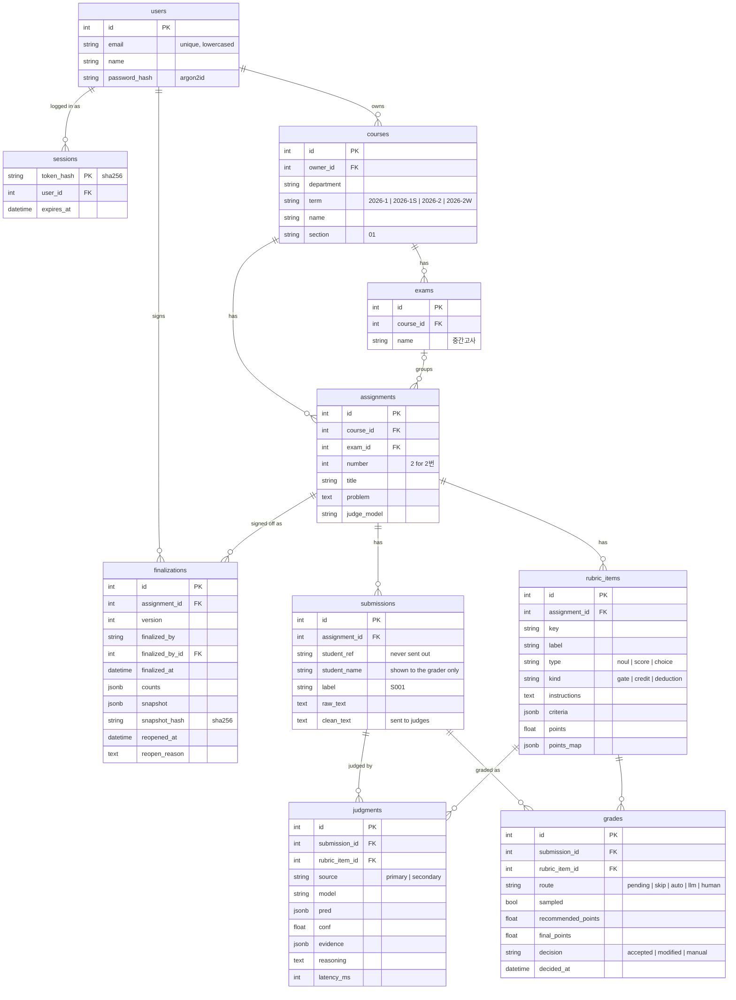

# 개발 문서

FastABC의 구조와 주요 규칙을 설명합니다. 실행 방법은 [README](../README.md)를, 화면 흐름은 [사용 시나리오](scenario.md)를 보세요.

## 설계 원칙

1. **AI는 추천만, 확정은 사람이.** 시스템은 추천 점수와 판단 이유만 보여 줍니다. 점수 칸을 미리 채우지 않습니다.
2. **판단 단위는 채점 기준 항목.** 답안 전체를 상태로 두고 항목마다 판단 질문을 던집니다. 항목들은 한 요청에서 함께 평가됩니다. 이 "답안 × 항목"을 칸이라 부릅니다.
3. **판단은 판단 모델, 생성은 LLM, 규칙은 코드.** 점수 계산, 분기, 라우팅은 모델 출력이 아니라 코드가 정합니다.
4. **업체 중립.** 공통 코드, DB, 화면은 역할 이름(primary/secondary, "판단 모델"/"LLM")만 씁니다. 업체 이름은 어댑터(`app/judges/jev.py`, `gemini.py`)와 조립 지점(`app/grading/engine.py`의 `make_judges`)에만 나옵니다.
5. **학생 정보는 밖으로 나가지 않는다.** 외부 API에는 식별 정보를 지운 `clean_text`만 보냅니다. 채점자는 자기 과목만 봅니다.
6. **자동화 편향 방지.** 한 번에 확정할 수 있는 칸은 확신 높은 칸뿐이고, 그중 일부는 무작위 점검으로 뺍니다. 모든 확정은 추천 수용, 수정, 직접 입력으로 기록됩니다.
7. **모든 답안은 사람이 한 번은 본다.** 일괄 확정은 학생 한 명 단위로만 있고, 문항 전체를 한 번에 확정하는 기능은 두지 않습니다.

## 디렉터리

서버 코드는 도메인별 폴더로 나뉩니다. 폴더마다 `models.py`(테이블), `deps.py`(소유권 확인), `router.py`(화면과 요청 처리)를 두고, 필요한 도메인만 규칙 모듈을 더 둡니다.

```
app/
  main.py              FastAPI 앱: 정적 파일, 라우터 등록, 로그인 안 된 화면 요청을 /login으로
  models.py            모든 모델을 한곳에서 불러오는 목록 (Alembic·문자열 관계용) + 공통 열거형, 확정·가져온 점수 모델
  core/                db(엔진·세션), security(비밀번호 해시·토큰), config(쿠키·환경 변수), templates(Jinja2·필터), errors
  accounts/            사용자·세션, 로그인·로그아웃
  courses/             과목·시험, 과목 목록·과목 화면·시험 화면
  problems/            문항·채점 기준 항목, 새 문항 화면, 문항 화면
  submissions/         답안, 시험 CSV 업로드(csv.py), 식별 정보 제거(redact.py)
  grading/             판단 기록·칸, 채점 실행(engine.py), 채점 시작·진행 칸
  review/              채점 화면, 칸 확정·학생 단위 일괄 확정(logic.py), 문항·시험 결과(results.py), 성적 확정·개정
  judges/
    base.py            Judge 프로토콜과 Judgment (업체 중립)
    routing.py         라우팅 규칙 (skip / auto / llm / human)
    jev.py             판단 모델 어댑터 (TypeSafe Jev)
    gemini.py          LLM 어댑터 (Google Gemini)
  scoring.py           판단 → 점수, 항목별 점수 범위, 총점
  finalization.py      성적 확정: 스냅샷, 해시, 잠금
  templates/           Jinja2 화면 (base, login, courses, exams, problems, grading, review)
  static/              app.css, Pico CSS 2.0.6, htmx 2.0.4 (파일로 고정, 외부 CDN 없음)
alembic/               마이그레이션
scripts/               seed_demo.py(--empty, --booth), booth_reset.py, export_rubric.py, run_eval.py
tests/                 pytest (실제 API 호출 없음)
notebooks/             판단기 응답 검증 노트북 (01 Jev, 02 Gemini)
data/
  eval/                평가셋 (문항, 답안, 채점자 라벨)과 실행 기록(runs/)
  demo/                데모 답안 CSV, 3번 문항 채점 기준
docs/                  사용 시나리오, 개발 문서
Dockerfile             서버용 이미지 (시작 때 마이그레이션)
docker-compose.yml     로컬 개발용 DB
compose.prod.yml       서버 한 대: DB, 앱, Caddy
Caddyfile              https 인증서와 앱으로 넘기기
```

도메인 사이의 import 방향은 한쪽입니다: `core ← judges ← accounts ← courses ← problems ← submissions ← grading ← review`. 라우터는 어느 도메인이든 불러올 수 있습니다.

## 데이터 모델



- **칸**은 답안 × 채점 기준 항목입니다. `grades`가 칸 하나의 추천과 채점자 확정을 담고, `judgments`는 판단기의 원본 출력을 모두 남깁니다.
- 주제 확인 항목(`kind = gate`, key `is_on_topic`)은 점수가 없어 `grades`를 만들지 않고 `judgments`에만 남습니다.
- **코드 이름과 DB 이름:** 코드는 `Problem`, `Criterion`, `problem_id`, `criterion_id`, `Problem.text`, `Criterion.descriptions`라고 부르지만, 테이블·열 이름은 프로토타입 그대로(`assignments`, `rubric_items`, `assignment_id`, `rubric_item_id`, `problem`, `criteria`)입니다. `mapped_column("assignment_id", …)`처럼 열 이름을 첫 인자로 주어 마이그레이션 없이 이름만 바꿨습니다.
- 학생 이름과 학번은 채점자 화면에만 씁니다. 외부 API에는 `clean_text`만 보냅니다.
- 과목 이름(학과·학기·과목·분반)은 채점자마다 따로 겹치지 않으면 됩니다. 학기는 `연도-구분`으로 저장합니다. 구분은 `1`(1학기), `1S`(여름 계절학기), `2`(2학기), `2W`(겨울 계절학기)이고, 이 표기는 글자 순서가 곧 달력 순서라 그대로 정렬해도 됩니다.
- 프로토타입이 쓰던 테이블 `imported_parts`·`imported_scores`(다른 곳에서 채점한 점수), `term_schedules`(성적 입력 마감일)와 `finalizations.late` 열은 DB에 남아 있지만 지금 화면은 쓰지 않습니다. 가져온 점수는 데모 시드만 채웁니다.

## 채점 흐름

1. **문항 만들기** (`POST /exams/{id}/problems`): 채점자가 항목마다 이름, 가점·감점, 배점, AI가 확인할 내용을 적습니다. 저장할 때 주제 확인 항목(`GATE_ROW`)을 맨 앞에 넣고, 채점자가 쓴 "답안"을 판단기가 읽는 `` `answer` `` 표기로 바꿉니다(`ANSWER_WORD`). 화면에 보일 때는 `plain` 필터가 되돌립니다. 항목 검증은 `problems/schemas.py`의 `CriterionIn`이 맡고, 실패하면 입력을 그대로 둔 채 화면을 다시 그립니다.
2. **업로드** (`POST /exams/{id}/submissions`): 시험 단위 CSV 하나를 받습니다(5 MB, UTF-8 또는 CP949). 열은 `학번`, 선택 `이름`(또는 `성명`), 문항마다 `1번`·`문항 2`·`3` 같은 열입니다. 이 시험에 없는 번호의 열은 무시합니다. 빈 칸은 미제출, 이미 답안이 있는 학생과 성적 확정된 문항은 건너뛰고 그 수를 화면에 알리므로, 같은 파일을 행을 늘려 다시 올려도 됩니다. 라벨은 문항마다 `S001`부터 붙입니다. `redact()`가 학번·이름을 지우고 `학번:`·`이름:` 같은 표시와 이메일·전화번호·학번 패턴을 정규식으로 지운 `clean_text`를 만듭니다.
3. **1차 판단** (`POST /problems/{id}/grade`, `run_primary`): 판단 모델이 답안마다 모든 질문을 한 번에 판단합니다. 각 `Judgment`의 `confident`는 어댑터가 자기 임계값으로 정합니다. Jev는 예/아니오 확신도가 |2p−1|이고 임계값은 0.6이며, 수준과 선택형은 0.8입니다. 라우팅은 `confident`만 읽습니다.
   - 주제 확인에 "아니오"로 확신하면 나머지 칸은 `skip`(0점 추천)입니다.
   - 확신하면 `auto`가 되고, 답안의 10%(`SAMPLE_RATE`)를 골라 각각 `auto` 칸 하나를 `sampled`로 표시합니다(`draw_audits`). 항목마다 뽑으면 답안 절반에 점검이 붙어서 답안 단위로 뽑습니다. 채점 한 번에 최소 한 답안은 뽑고, 시드는 문항 id라 다시 채점해도 같은 칸이 뽑힙니다.
   - 확신하지 못하면 `pending`입니다.
   - 판단 모델 호출이 실패하면 아무것도 저장하지 않고 문항 화면에 오류를 띄웁니다. 확정된 칸이 하나라도 있으면 다시 채점할 수 없습니다.
4. **재판단** (`escalate`, FastAPI `BackgroundTasks`): `pending` 칸만 모아 LLM에 답안당 한 번 묻습니다. 호출은 `SECONDARY_PARALLEL`(4)개씩 동시에 보내고 결과는 한 스레드에서 끝난 순서대로 씁니다. 판단이 같으면 `llm`(추천과 판단 이유)이 되고, 다르거나 LLM이 실패하면 `human`(추천 없음)이 됩니다. 답안마다 커밋하므로 진행 칸(`GET /problems/{id}/progress`)이 경로별 개수를 그대로 셉니다.
5. **확정** (`POST /grades/{id}`, `review/logic.decide`): 점수 칸 하나를 누르면 그 점수로 확정합니다. 추천과 같으면 `accepted`, 다르면 `modified`, 추천이 없었으면 `manual`로 기록합니다. 빈 값은 확정 취소입니다. 항목에 줄 수 없는 점수(`point_options` 밖)와 재판단 대기 칸은 거부합니다.
6. **학생 단위 일괄 확정** (`POST /submissions/{id}/accept`, `accept_confident`): 이 학생의 칸 중 미확정이고 `auto`·`skip`이며 무작위 점검이 아닌 칸(`bulk_target`)만 추천대로 확정하고, 확정할 칸이 남은 다음 학생(라벨 순)으로 보냅니다.
7. **성적 확정** (아래 절).

## 화면과 주소

화면은 서버가 Jinja2로 그리고, 일부만 htmx로 갈아 끼웁니다. 폼은 POST 뒤 303으로 화면 주소로 돌려보내고, 오류는 `?error=` 문구로 전합니다.

| 메서드 | 주소 | 화면·동작 |
|---|---|---|
| GET, POST | `/login` | 로그인 화면, 로그인 |
| POST | `/logout` | 로그아웃 |
| GET | `/` | 내 과목 목록, 과목 추가 폼 |
| POST | `/courses` | 과목 추가 (분반은 두 자리로, 중복이면 화면에 알림) |
| GET | `/courses/{id}` | 과목: 시험 목록, 시험 추가 폼 |
| POST | `/courses/{id}/exams` | 시험 추가 |
| GET | `/exams/{id}` | 시험: 문항 목록, 학생별 문항 점수와 합계, 답안 CSV 올리기 |
| POST | `/exams/{id}/submissions` | 시험 CSV 업로드 |
| GET | `/exams/{id}/problems/new` | 새 문항 |
| POST | `/exams/{id}/problems` | 문항 저장 |
| GET | `/problems/{id}` | 문항: 문제, 채점 기준 표, 채점 시작·진행, 결과 표, 성적 확정·개정·이력 |
| POST | `/problems/{id}/grade` | 채점 시작 (재판단은 백그라운드) |
| GET | `/problems/{id}/progress` | 진행 칸 조각 (htmx, 재판단이 남은 동안 2초마다 자기 자신을 다시 부름) |
| GET | `/problems/{id}/review` | 확인이 필요한 첫 학생(없으면 첫 학생)의 채점 화면으로 |
| GET | `/problems/{id}/review/{답안 id}` | 학생별 채점 화면 |
| POST | `/grades/{id}` | 칸 확정·수정·취소, 그 항목 줄 조각을 돌려줌 (htmx `hx-target="closest .criterion-row"`) |
| POST | `/submissions/{id}/accept` | 학생 단위 일괄 확정 후 다음 학생으로 |
| POST | `/problems/{id}/finalize` | 성적 확정 (책임 확인 체크 필수) |
| POST | `/problems/{id}/reopen` | 개정 (사유 필수) |

채점자 화면은 내부 경로 이름을 쓰지 않고 아래처럼 보여 줍니다.

| 내부 (`grades.route`, `sampled`) | 채점자 화면 | 추천 | 학생 단위 일괄 확정 |
|---|---|---|---|
| `human` | AI 의견이 갈림: 1차 판단과 재확인을 나란히, 재확인의 이유 | 없음 | 제외 |
| `llm` | AI가 다시 확인함: 재확인의 판단 이유 | 있음 | 제외 |
| `auto` + `sampled` | 무작위 점검: 고른 이유 한 줄 | 있음 | 제외 |
| `auto` | 표시 없음 | 있음 | 대상 |
| `skip` | 표시 없음 (0점 추천) | 0점 | 대상 |
| `pending` | 진행 칸에 "AI가 다시 보는 중" | 없음 | 확정 불가 |

- 점수 칸은 항목마다 받을 수 있는 점수(`point_options`: 가점은 0과 배점, 감점은 −배점과 0, 수준별은 수준별 점수)를 한 줄로 보여 줍니다. AI 추천 칸은 점선 테두리(`data-recommended`)만 두고 미리 채우지 않으며, 고른 칸은 `aria-pressed`로 채웁니다.
- 학생 목록은 라벨 순이고, 학생마다 확인 필요 항목 수(다 끝나면 ✓)를 붙입니다.

## 판단기 바꾸기

판단기는 `app/judges/base.py`의 프로토콜 하나만 구현하면 됩니다.

```python
class Judge(Protocol):
    def evaluate(self, problem: str, answer: str, questions: Questions) -> list[Judgment]: ...
```

- 1차 판단기는 `Judgment.conf`와 `confident`를 채워야 합니다. 임계값은 모델 버전마다 다시 맞춰야 하므로 어댑터 안에 둡니다.
- 2차 판단기는 `pred`, `evidence`(답안에서 그대로 복사한 문장), `reasoning`을 채웁니다. LLM이 스스로 밝힌 확신도는 쓰지 않습니다.
- 새 판단기는 `app/grading/engine.py`의 `make_judges()`에서만 조립합니다. 채점 시작은 FastAPI 의존성 `get_judges`로 판단기를 받으므로, 테스트에서는 가짜 판단기로 덮어써 외부 API를 부르지 않습니다.

## 계정과 로그인

- 외부 인증 서비스 없이 직접 구현했습니다. 계정은 시드 스크립트가 만드는 데모 계정을 씁니다(가입 화면 없음). 이메일 인증, 비밀번호 재설정, 역할 구분, 과목 공유는 하지 않습니다.
- 비밀번호는 argon2id(`argon2-cffi`)로 해시합니다. 없는 이메일로 로그인해도 더미 해시를 검증해 응답 시간으로 계정 여부가 드러나지 않게 합니다.
- 로그인하면 임의 토큰을 httpOnly, SameSite=Lax 쿠키(`fastabc_session`, 14일)로 줍니다. DB에는 토큰의 sha256만 저장하고, 로그아웃하면 세션 행을 지웁니다. https 뒤에서는 `COOKIE_SECURE=1`로 Secure를 켭니다.
- 모든 화면은 `page_user` 의존성으로 로그인한 사용자를 받습니다. 로그인하지 않았으면 `LoginRequired`를 던지고 `main.py`가 `/login`으로 보냅니다.
- 과목·시험·문항·답안·칸은 `own_course`, `own_exam`, `own_problem`, `own_submission`, `own_grade`로 불러옵니다. 다른 사람의 것은 403이 아니라 404로 답해 id로 존재 여부를 알 수 없게 합니다.
- 서버(`compose.prod.yml`)에서는 Caddy가 https를 맡고 앱으로 넘깁니다. 앱은 `FORWARDED_ALLOW_IPS`로 Caddy가 보낸 원래 scheme을 믿어, 화면이 만드는 정적 파일 주소가 https로 나옵니다. 앱 포트는 밖에 열지 않습니다.

## 성적 확정

- `POST /problems/{id}/finalize`는 책임 확인 체크가 있어야 하고, 확정자는 로그인한 사용자로 기록합니다(`finalized_by`에 그때의 이름, `finalized_by_id`에 계정). 재판단 대기 칸이 있거나 이미 잠겼으면 확정하지 않습니다. 확정 폼은 미확정 칸이 없을 때만 보입니다.
- 학생별 항목 점수, 확정 종류, 총점을 담은 스냅샷을 키를 정렬한 JSON으로 직렬화해 sha256 해시를 만들고, 확정 종류별 칸 수와 함께 새 버전으로 저장합니다(`finalization.snapshot`, `digest`). 점수가 같으면 해시도 같습니다.
- 최신 버전이 개정되지 않은 동안 문항은 잠깁니다. 칸 확정·취소, 학생 단위 일괄 확정, 답안 업로드는 막힙니다(`finalization.ensure_unlocked`, `is_locked`).
- `POST /problems/{id}/reopen`은 사유를 필수로 받아 최신 버전에 개정 시각과 사유를 남기고 잠금을 풉니다. 다시 확정하면 다음 버전이 됩니다. 문항 화면의 확정 이력에 모든 버전과 개정 사유가 남습니다.
- **시험 결과**(`review/results.exam_results`): 학번으로 문항별 총점을 묶습니다. 답안이 없는 문항은 미제출(0점), 미확정 칸이 남은 학생은 합계를 비웁니다.
- 전자 서명(확정자 개인 키로 스냅샷 서명)은 후속 과제입니다.

## 평가 도구

채점자가 직접 라벨링한 평가셋으로 하이브리드와 LLM 단독을 비교합니다.

```bash
uv run python scripts/export_rubric.py --assignment 7 --id q1_password_storage   # 앱 문항 → data/eval/<id>/question.json, 답안 템플릿
uv run python scripts/run_eval.py run                                            # API 호출, runs/<시각>/raw/*.jsonl에 원본 기록
uv run python scripts/run_eval.py analyze --run data/eval/runs/<시각>             # 오프라인 분석: summary.md, CSV, 그래프
```

- `run`은 답안마다 1차 판단, 재판단, LLM 단독 판단, 근거 찾기 네 가지 호출을 기록합니다. 중단되면 `--resume`으로 이어 갑니다.
- `analyze`는 기록만 읽으므로 비용 없이 다시 돌릴 수 있습니다. 라벨 일치도, 경로별 정확도, 임계값별 자동 처리율, 확신도 구간별 정확도, 비용과 지연을 냅니다.
- 라벨은 `answers.csv`에 예/아니오는 `1`/`0`, 수준은 번호로 적고, 판단기를 돌리기 전에 채웁니다.
- 평가 실행(2026-11-08)은 프로토타입에서 했고, 판단기·라우팅 코드는 지금 버전에서도 그대로입니다.

## 테스트와 규칙

- `uv run pytest`: 점수 계산(`test_scoring`), 판단기 응답 해석과 확신도 임계값·라우팅(`test_judges`), 식별 정보 제거(`test_redact`)를 확인합니다. 외부 API는 부르지 않습니다. DB가 필요한 테스트는 별도 DB `fastabc_test`에 테이블을 만들고 테스트마다 롤백합니다.
- 화면은 데모 데이터로 주요 주소를 열어 확인합니다.
- 스키마를 바꾸면 `uv run alembic revision --autogenerate -m "..."`로 마이그레이션을 만들고 `uv run alembic upgrade head`로 적용합니다.
- API 키는 루트 `.env`에만 둡니다. 무료 LLM 키는 합성 데이터에만 쓰고, 실제 학생 답안은 입력이 학습에 쓰이지 않는 유료 계정으로만 보냅니다.
